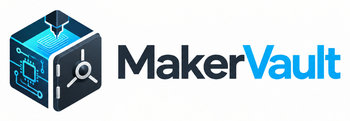
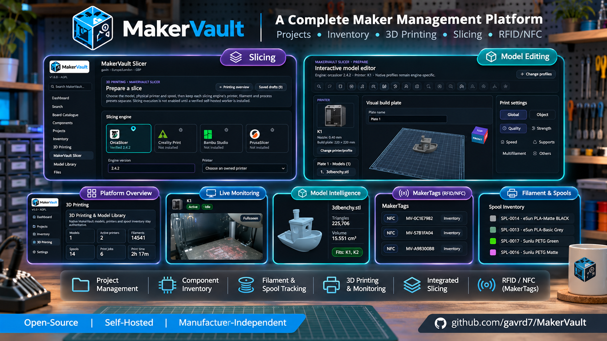

<p align="center">
  
</p>

<h1 align="center">MakerVault</h1>
<p align="center"><strong>Your workshop, organised.</strong></p>
<p align="center">A self-hosted workspace for electronics, making and 3D printing — from the parts you own to the things you build.</p>
<p align="center"><strong>Application version: v1.7.0</strong></p>
<p align="center">
  <a href="https://gavrd7.github.io/MakerVault-docs/">User guide</a> ·
  <a href="https://gavrd7.github.io/MakerVault-docs/slicer/">Slicer guide</a> ·
  <a href="docs/guide/getting-started/install.md">Install</a> ·
  <a href="docs/ROADMAP.md">Detailed roadmap</a> ·
  <a href="CHANGELOG.md">Changelog</a> ·
  <a href="https://github.com/gavrd7/MakerVault-Hardware">Hardware</a> ·
  <a href="DEVELOPMENT_PARTNERS.md">Development partners</a>
</p>

<p align="center">
  
</p>

## Why MakerVault?

Maker projects rarely live in one place. Components end up in boxes and spreadsheets, model revisions in folders, filament in a separate tracker and build notes scattered across apps. **MakerVault connects your physical workshop with its digital records** so you can find what you own, see what a project needs, and keep track of what you made.

- **Self-hosted and private:** run on your own Docker server, with your database and files under your control; no MakerVault cloud subscription required.
- **One connected workflow:** link components, inventory, projects, bills of materials, models, prints and finished parts rather than maintaining separate lists.
- **Useful on the workbench:** responsive desktop/mobile UI, QR/RFID/NFC MakerTags and optional connected hardware.
- **Built for real stock:** track physical quantities, locations and allocations separately from reference catalogues.

<p align="center">
  
</p>

## Install MakerVault

MakerVault runs on your own computer or server using Docker. The standard installation includes MakerVault Slicer in its own container, alongside the application, PostgreSQL and Redis.

**Quick start on Linux** (requires Docker Compose, Git and Python 3):

```bash
git clone https://github.com/gavrd7/MakerVault.git
cd MakerVault
python3 scripts/generate_env_secrets.py
```

Edit the generated `.env` with your server address, then start the four-container stack:

```bash
sudo docker compose up -d
```

Open **`http://YOUR-SERVER-IP:8765`** in your browser and follow the initial setup wizard.

**MakerVault Slicer** runs in a separate container and supports OrcaSlicer, Creality Print and Bambu Studio. Use the [dedicated slicer guide](https://gavrd7.github.io/MakerVault-docs/slicer/) for installation, engine management, profiles and painting, or the [in-repository reference](docs/guide/3d-printing/slicer.md).

For detailed instructions, see the [Linux installation guide](docs/guide/getting-started/install.md), [Windows / Docker Desktop guide](docs/guide/getting-started/windows.md), [environment configuration](docs/guide/getting-started/environment.md) and [first sign-in guide](docs/guide/getting-started/first-sign-in.md). Already using MakerVault? Follow the [upgrade guide](docs/guide/administration/updates.md) and [backup guide](docs/guide/administration/backup.md) instead of starting from scratch.

## Features available now

| Area | What MakerVault offers |
| --- | --- |
| **Inventory and catalogues** | Electronic boards and components, searchable reference specifications and images, physical item IDs, quantities, locations, condition and provenance-aware catalogue enrichment |
| **Projects and bills of materials** | Project workspaces, notes, files, build information, BOMs, quantity-aware stock allocation and cost tracking |
| **Wiring Lab** | Interactive wiring diagrams, catalogue-aware pin selection, basic electrical checks and JSON/SVG export |
| **Files and 3D models** | Private files with version history; STL/3MF viewing and analysis; model revisions; printer-fit and orientation assistance; plain-text G-code library with bounded XY path preview, source inspection and save-as-new-version editing |
| **MakerVault Slicer** | Independently installed OrcaSlicer, Creality Print and Bambu Studio engines; native profiles and build-plate preparation, supports, multicolour, painting, variable layers, G-code review, and per-engine version management |
| **G-code transfer and printing** | Explicit upload-only, upload-and-start or start-existing-printer-file workflows from compatible live printer connections; per-adapter file browsing and print verification; Creality K2 CFS mapping where supported (hardware validation varies) |
| **3D printers and materials** | Printer inventory, filament products, physical spools, reusable spool hardware, printed parts, print history and material/cost reporting |
| **Live integrations** | Optional local printer monitoring and compatible camera feeds, supported printer controls, Spoolman review and Creality CFS material-database read-only snapshots |
| **MakerTags** | Printable QR labels, stable `MV-XXXXXXXX` identities, RFID/NFC UID association, reassignment history and verified NTAG215 URLs; **Clean NFC data**, **Remove MakerTag**, and optional clean-before-remove |
| **Connected Devices** | Certificate-verified HTTPS pairing, device permissions and heartbeats; with **MakerVault Terminal v1.0**, browse records, create MakerTags, scan filament RFID tags and identify physical spools from the handheld |
| **Search and administration** | Universal search, role-based access, optional OIDC/MFA, account quotas, backups, guarded restore and catalogue-maintenance tools |

**G-code availability:** K1 native storage browsing and print-start were tested on a clean stock-firmware installation; K2 native HTTP transfer, Moonraker print-start and K1/K2 same-origin camera previews were also tested. A print-start command is sent only after confirmation, is not silently retried, and counts as verified only after correlated printer telemetry. Proprietary K2 mapped-CFS start and other manufacturer-specific transfers remain subject to hardware/firmware checks. The G-code Library reviews existing output, while MakerVault Slicer generates G-code through an installed and verified native engine; binary BGCODE editing is not supported.

**Compatibility notes:** Printer support and available controls vary by manufacturer, firmware and connection method. Some adapters are monitoring-only or have limited real-hardware validation; see the [user guide](https://gavrd7.github.io/MakerVault-docs/) and [hardware-validation issue](https://github.com/gavrd7/MakerVault/issues/37). MakerVault does not automatically deduct physical spool stock from every estimated print.

### Where the pieces connect

An inventory item can be allocated to a project BOM. A model and its revisions can be associated with a build; a recorded print can produce a tracked physical part. A MakerTag on a box, spool or printed object can bring you back to its current record. These links make the system more useful than isolated inventory or printer dashboards.

**Terminal interoperability:** a paired terminal can resolve CFS material identifiers against cached Creality printer databases, identify physical spools by either of up to two separate RFID UIDs, and scan each side of a spool on request from the Physical Identity form. Manufacturer material names require online MakerVault access; offline tag data remains readable. Third-party RFID support depends on compatible tags and available documentation, not universal compatibility.

### MakerTag cleaning and removal

The MakerTag maintenance workflow has three **distinct** actions:

- **Clean NFC data:** a paired MakerVault Terminal erases and independently verifies the writable NTAG215 NDEF user data, while **keeping** the MakerTag registration, linked inventory record and permanent URL in MakerVault.
- **Remove MakerTag:** removes the registration (and makes its short URL stop resolving) but leaves the physical NFC tag unchanged.
- **Remove and clean:** explicitly cleans and verifies the physical tag **first**, then removes the registration. If the wipe fails, the record is kept; if later server removal fails, MakerVault reports partial completion rather than claiming both steps succeeded.

These operations are implemented and maintainer-tested in the merged [application PR #165](https://github.com/gavrd7/MakerVault/pull/165) and [terminal firmware PR #12](https://github.com/gavrd7/MakerVault-Hardware/pull/12), **available since MakerVault v1.5.1 and included in v1.7.0**, with matching Terminal firmware v1.0.1. Cleaning applies to supported, writable, unprotected **NTAG215 MakerTags only**; it never erases the chip UID or manufacturer/configuration pages, unrelated inventory records, or Creality/Bambu/Elegoo filament tags. See the [MakerTags guide](https://gavrd7.github.io/MakerVault-docs/using/maker-tags/) for the end-user instructions in the corresponding updated guide.

### Terminal connection reliability

The matching terminal firmware in [MakerVault-Hardware PR #12](https://github.com/gavrd7/MakerVault-Hardware/pull/12) now uses native ESP-IDF `esp_http_client`, a persistent verified HTTPS session and correct C++/FreeRTOS worker-buffer cleanup. MakerVault retains the **single authenticated five-second idle snapshot** (`GET /api/device/v1/pending-work/`) in place of four separate pending-operation requests. Heartbeats, device scope checks and physical-write authorisation remain separate and cannot be inferred from the snapshot.

For direct port-8443 deployments, the native Gunicorn HTTPS listener defaults to a **15-second keep-alive**, configurable with `HTTPS_KEEPALIVE_SECONDS`. This is long enough to span normal terminal idle polls; a separate reverse proxy must also allow reuse on its **device-facing HTTPS connection**. The maintainer's two-hour-plus physical terminal test showed stable idle heap, continuous successful polls and no memory-recovery reboots. Transport switching or keep-alive alone is not a substitute for TLS verification. See [HTTPS/reverse-proxy guidance](docs/guide/advanced/reverse-proxy.md) and [configuration reference](docs/guide/reference/configuration.md).

## Roadmap

A concise view of what's delivered and where MakerVault may go next. Checkmarks refer to implemented functionality, **not** universal compatibility with every printer or hardware model. The [detailed roadmap](docs/ROADMAP.md), [issues](https://github.com/gavrd7/MakerVault/issues) and [changelog](CHANGELOG.md) provide scope, validation notes and release history.

### Available

- [x] Integrated MakerVault Slicer for OrcaSlicer, Creality Print and Bambu Studio, independently installed and explicitly verified through the combined slicer service.
- [x] Self-hosted Docker deployment, first-run setup, account security and managed backup/restore
- [x] Electronic component/board catalogues, physical inventory and storage locations
- [x] Projects, BOMs, stock allocation, files and version history
- [x] Interactive Wiring Lab and searchable workshop records
- [x] 3D model library, STL/3MF previews, analysis and print history
- [x] Filament products, physical/reusable spools, printed parts and cost tracking
- [x] Optional live printer integrations, monitoring, cameras and supported controls
- [x] G-code Library, source inspection and XY preview, immutable edits, printer storage browsing and explicit upload/start with supported native or generic adapters; K1/K2 LAN integration and local WebRTC camera previews, subject to firmware and adapter validation ([guide](https://gavrd7.github.io/MakerVault-docs/using/gcode-and-print-submission/), [issue #155](https://github.com/gavrd7/MakerVault/issues/155))
- [x] MakerTags with QR, RFID/NFC association and verified NTAG215 URL writing
- [x] Connected Devices pairing and terminal-first MakerTag creation and one- or two-tag physical spool RFID identification (Terminal v1.0)

### Planned / under evaluation


- [ ] **Additional native slicing engines and interoperability:** build on the existing OrcaSlicer, Creality Print and Bambu Studio integrations after per-engine validation.
- [ ] **MakerVault Weigh Station:** connected scale/RFID hardware with a removable printable platform (hardware development)
- [x] **Read-only CFS material-tag decoding**, K2 printer material-database snapshots, scoped online material lookup and explicit physical spool UID association; no CFS tag writing or printer database push
- [ ] Expanded real-hardware validation and compatibility for printer/camera adapters ([issue #37](https://github.com/gavrd7/MakerVault/issues/37))
- [ ] User-selectable appearance themes and palettes ([issue #124](https://github.com/gavrd7/MakerVault/issues/124))

These are roadmap intentions, not promises for the next release.

## Project and documentation

- **[MakerVault User Guide](https://gavrd7.github.io/MakerVault-docs/)** ([source](https://github.com/gavrd7/MakerVault-docs)) — installation, daily use, administration and troubleshooting.
- **[MakerVault Slicer Guide](https://gavrd7.github.io/MakerVault-docs/slicer/)** — a dedicated walkthrough for OrcaSlicer, Creality Print, Bambu Studio, profiles, painting and G-code review.
- **[MakerVault-Hardware](https://github.com/gavrd7/MakerVault-Hardware)** — terminal firmware, 3D-printable enclosure, wiring and future connected hardware.
- **[Changelog](CHANGELOG.md)** — release-by-release features and fixes.
- **[Detailed roadmap](docs/ROADMAP.md)** — delivered milestones, implementation constraints and outstanding validation.
- **[Contributing](CONTRIBUTING.md)** · **[Security](SECURITY.md)** — project contribution and vulnerability guidance.

**Development approach:** MakerVault is an AI-coded project developed under human direction. The maintainer owns product decisions and physical acceptance testing; automated checks and AI-generated code are not substitutes for real-world validation.

**Data and security:** Database, media, encryption keys and configuration require coordinated backups. Private-file encryption does not encrypt the entire database or every secret. Do not expose a development environment, untrusted printer integration or provisioning portal directly to the internet.

**Licence:** MakerVault-authored code is licensed under the [GNU Affero General Public License v3](LICENSE); third-party content retains its own licensing and attribution.

## Contact

- **General project enquiries:** [maker@makervault.co.uk](mailto:maker@makervault.co.uk)
- **Manufacturer and development partnerships:** [partnerships@makervault.co.uk](mailto:partnerships@makervault.co.uk) — see [Development Partners](DEVELOPMENT_PARTNERS.md).
- **User support:** [support@makervault.co.uk](mailto:support@makervault.co.uk). For bugs and reproducible feature requests, please prefer the [GitHub issue forms](https://github.com/gavrd7/MakerVault/issues/new/choose) so updates remain trackable; see [Support](SUPPORT.md).

**Security vulnerabilities:** do not send sensitive details through public issues; follow [the private reporting policy](SECURITY.md).
